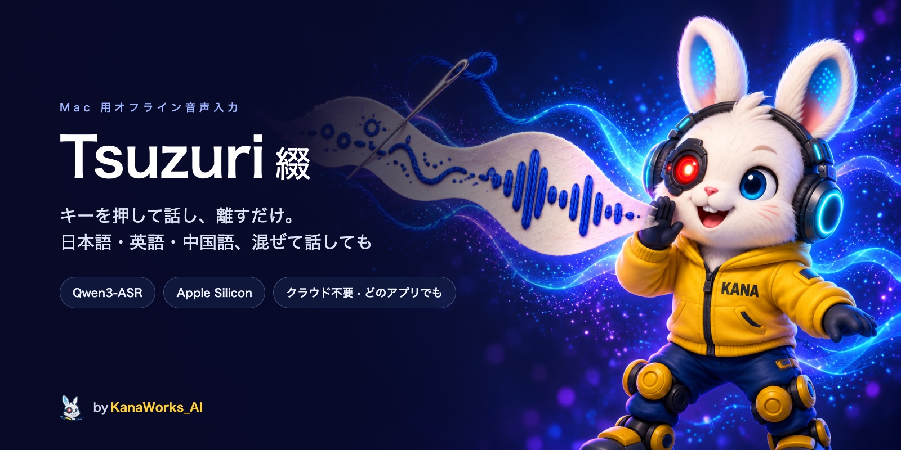

<div align="center">



<p>
  <a href="LICENSE"></a>
  
  
  <a href="https://github.com/kanaworksai-hue/tsuzuri/releases/latest"></a>
  <a href="https://github.com/kanaworksai-hue/tsuzuri/stargazers"></a>
</p>

<p><a href="https://github.com/kanaworksai-hue"></a>&nbsp;<a href="https://github.com/kanaworksai-hue"><b>A KanaWorks_AI project</b></a></p>

[English](README.md) | **日本語** | [简体中文](README.zh-CN.md)

[インストール](#-インストール) · [使い方](#%EF%B8%8F-使い方) · [テキスト整形](#-テキスト整形) · [ソースからビルド](#%EF%B8%8F-ソースからビルド) · [コマンドライン](#%EF%B8%8F-コマンドライン) · [よくある質問](#-よくある質問)

</div>

**Tsuzuri 綴（つづり）** は macOS 用のオフライン音声入力アプリです。キーを押しながら話して離すだけで、カーソルのある場所に文字が入ります。**日本語・英語・中国語、そして 1 つの文の中で混ざった話し言葉**も、モードを切り替えずにそのまま認識します。

認識はすべてお使いの Mac の中で行います。[Qwen3-ASR](https://github.com/QwenLM/Qwen3-ASR) を [MLX](https://github.com/ml-explore/mlx-swift) で Apple Silicon 上で動かしています。クラウドもアカウントも不要で、音声が Mac の外に出ることはありません。

## ✨ 特長

- **メニューバー常駐**、Dock にアイコンは出ません
- **押して話す**：トリガーキー（既定は右 ⌥ Option。右 ⌘ Command や Fn も選べます）を押している間だけ録音。短く押すと録音開始、もう一度押すと停止。Esc でキャンセル
- **言語が混ざっても大丈夫**：「明日の stand-up は skip して、PR の review を先にやろう」もそのまま入力できます
- **どのアプリでも使える**：日本語入力をオンにしたままでも OK。文字はクリップボード経由で貼り付け、元のクリップボードはあとで元に戻します
- **話した内容をなくさない**：テキスト欄にフォーカスがないときはクリップボードに残し、メニューに最近の 10 件を保持します（メモリ上のみ）
- **2 つのモデルサイズ**：Qwen3-ASR 1.7B（高精度）と 0.6B（高速）
- **テキスト整形**（任意）：ローカルの小型モデルで句読点を付け、フィラーを取り除き、数字を算用数字にします
- [Silero VAD](https://github.com/snakers4/silero-vad) で前後の無音をカット
- メニューは日本語・英語・簡体字中国語に対応（macOS の言語設定に合わせて切り替わります）

## 📦 インストール

**動作環境：** Apple Silicon（M1 以降）の Mac、macOS 14 Sonoma 以降。起動中は 2 GB ほどの空きメモリが必要です。

### 1. アプリをダウンロード

[最新リリース](https://github.com/kanaworksai-hue/tsuzuri/releases/latest) から `Tsuzuri-<バージョン>.dmg` をダウンロードして開き、**Tsuzuri** を **アプリケーション** フォルダにドラッグします。アプリは Apple の署名・公証済みです。

### 2. 音声認識モデルをダウンロード

モデルはアプリに含まれていません。Tsuzuri は `~/Library/Application Support/Tsuzuri/Models/` からモデルを読み込みます。[uv](https://docs.astral.sh/uv/)（`brew install uv` でインストール）を使うのがいちばん簡単です。ターミナルに次を貼り付けてください：

```bash
M="$HOME/Library/Application Support/Tsuzuri/Models"
for repo in Qwen3-ASR-1.7B-4bit silero-vad; do
  uvx --from huggingface_hub hf download "mlx-community/$repo" --local-dir "$M/$repo"
done
```

ダウンロード量は約 1.5 GB です。より速く軽いモデルも使いたい場合は、リストに `Qwen3-ASR-0.6B-8bit` を追加してください（約 1 GB）。インストール済みのモデルはメニューから切り替えられます。

> Hugging Face CLI（`hf`）をお持ちなら、`hf download mlx-community/<repo> --local-dir "$M/<repo>"` でも構いません。

### 3. 初回の起動

1. アプリケーションフォルダから **Tsuzuri** を開きます。メニューバーに小さなアイコンが表示されます。
2. macOS に聞かれたら **マイク** へのアクセスを許可します。
3. システム設定 → プライバシーとセキュリティ → アクセシビリティ で **Tsuzuri** を許可します。ショートカットキーの検知と貼り付けに必要です。メニューからこの画面を直接開けます。
4. Tsuzuri の起動中にモデルをダウンロードした場合は、いったん終了して開き直してください。

## 🎙️ 使い方

1. メモ、ブラウザ、Slack、ターミナルなど、好きなアプリのテキスト欄をクリックします。
2. **右 ⌥ Option を押しながら**話し、離します。小さな表示が「聞き取り中…」、続いて「認識中…」に変わります。
3. カーソルの位置に文字が入ります。

キーを長押しせずに短く押すと、手を離したまま録音を続けられます。もう一度押すと停止します。Esc、またはトリガーキーを押している間に別のキーを押すとキャンセルです。

メニューバーのアイコンから、モデル、認識する言語（混ざった話し言葉には「自動」、または言語を固定）、ショートカットキー、テキスト整形のオン / オフを選べます。最近の認識結果をもう一度コピーすることもできます。

## 🪡 テキスト整形

テキスト整形をオンにすると、認識のあとにもう 1 つの小型モデル [spokenly/cleanup-1](https://huggingface.co/spokenly/cleanup-1) を通します。句読点を付け、フィラー（「えーと」「あのー」「um」など）を取り除き、言い直したときは言い直した方だけを残し、数字を算用数字にします。翻訳したり、話した内容に返事をしたりはしません。

結果がおかしいとき（極端に長い、文字の種類が変わった、話していない単語や数字が出てきた、1 秒以上かかった）は、整形前の認識結果をそのまま貼り付けます。コマンドを話すことが多いターミナルアプリでは整形しません。メモリは約 0.35 GB 増えます。

このモデルには MLX 版が用意されていないので、一度だけ Mac 上で変換してください（元のモデル 1.2 GB をダウンロードします）：

```bash
uvx --from 'mlx-lm==0.32.*' mlx_lm.convert --hf-path spokenly/cleanup-1 -q --q-bits 4 \
  --mlx-path "$HOME/Library/Application Support/Tsuzuri/Models/cleanup-1-4bit"
```

変換が終わったら Tsuzuri を開き直し、メニューの **テキスト整形** をオンにします。既定はオフです。

## 🛠️ ソースからビルド

Xcode 26 以降（Swift 6.2）が必要です。

```bash
git clone https://github.com/kanaworksai-hue/tsuzuri.git
cd tsuzuri
scripts/build-app.sh          # → build/Tsuzuri.app と .build/release/tsuzuri-cli
ditto build/Tsuzuri.app /Applications/Tsuzuri.app
```

`xcode-select` が Command Line Tools を指している場合も、スクリプトが自動的に `DEVELOPER_DIR=/Applications/Xcode.app/Contents/Developer` を使います。

`build-app.sh` は最初に見つかった「Apple Development」証明書で署名し、なければアドホック署名にします。macOS はマイクとアクセシビリティの許可を署名に結び付けるので、アドホック署名だとビルドし直すたびに許可し直す必要があります。

`scripts/release.sh <バージョン>` は「Developer ID Application」証明書で署名した DMG を作り、公証まで行います（詳しくはスクリプト内のコメントを参照。`SKIP_NOTARIZE=1` で署名のみ）。独自にビルドしたものを配布する場合は、別のアイコンを使ってください（[ライセンス](#-ライセンス) を参照）。

**翻訳：** UI の文字列はソースコードに英語で書いています（`String(localized:)` と SwiftUI の `Text`）。中国語と日本語の訳は `Resources/Localization/` にあります。文字列を追加・変更したら `python3 scripts/check-l10n.py` で訳の抜けを確認してください。

## ⌨️ コマンドライン

`tsuzuri-cli` は同じエンジンで音声ファイルを文字にします。実行ファイルの隣に `mlx.metallib` が必要ですが、`scripts/build-app.sh` が用意します。

```bash
.build/release/tsuzuri-cli recording.wav
.build/release/tsuzuri-cli --model Qwen3-ASR-0.6B-8bit --language Japanese a.wav b.m4a
.build/release/tsuzuri-cli --jsonl *.wav                      # ファイルごとに 1 行の JSON（処理時間付き）
.build/release/tsuzuri-cli --polish recording.wav             # 認識してからテキスト整形
.build/release/tsuzuri-cli --polish-text lines.txt            # テキスト整形のみ
```

すべてのオプションは `tsuzuri-cli --help` で確認できます。モデルを別のフォルダに置く場合は `TSUZURI_MODELS_DIR` を設定してください。

## ❓ よくある質問

**Mac の外に何か送られますか？** いいえ。録音、認識、テキスト整形はすべてローカルで動きます。ネットワークを使うのは、上のダウンロードコマンドを*ご自身で*実行するときだけです。

**話した内容はどこかに保存されますか？** 音声がディスクに書き込まれることはありません。最近の認識結果はメニュー用にメモリ上に置くだけで、終了すると消えます。`~/Library/Logs/Tsuzuri.log` には処理時間とエラーを記録しますが、話した内容は記録しません（デバッグ用に `defaults write com.kanaworks.tsuzuri logText -bool true` で記録するようにもできます）。

**なぜタイプ入力ではなくクリップボードで貼り付けるのですか？** 貼り付けなら、どのアプリでも、どの入力方式がオンでも同じように動くからです。元のクリップボードはあとで元に戻します。テキスト欄にフォーカスがあるか判断できないとき（一部の Electron アプリ）は、貼り付けたうえで文字をクリップボードに残すので、もう一度貼り付けられます。

**どのモデルを使えばいいですか？** まずは Qwen3-ASR 1.7B（4bit）から。速さやメモリの少なさを優先したいときは 0.6B（8bit）を試してください。

**既知の制限：** 中国語の文の中に短い日本語が混ざると、ローマ字や中国語の当て字で書かれることがあります。日本語の中の英単語はカタカナで書かれることが多いです（staging → ステージング）。貼り付けのショートカットは QWERTY 配列の V キーの位置を前提にしています。

## 🙏 謝辞

- Qwen チームの [Qwen3-ASR](https://github.com/QwenLM/Qwen3-ASR)（Apache-2.0）
- [mlx-audio-swift](https://github.com/Blaizzy/mlx-audio-swift)、[MLX Swift](https://github.com/ml-explore/mlx-swift)、[mlx-swift-lm](https://github.com/ml-explore/mlx-swift-lm)（MIT）
- [Silero VAD](https://github.com/snakers4/silero-vad)（MIT）
- [spokenly/cleanup-1](https://huggingface.co/spokenly/cleanup-1)（Apache-2.0）
- [Parrot](https://github.com/banyudu/parrot) と [Koe](https://github.com/imshire/koe)（MIT）のアイデアを参考にしています

ライセンス付きの一覧：[THIRD_PARTY.md](THIRD_PARTY.md)

## 📄 ライセンス

- **本プロジェクト：** [MIT](LICENSE)
- **モデル：** Hugging Face からダウンロードするもので、ここでは配布していません。[THIRD_PARTY.md](THIRD_PARTY.md) を参照してください。
- **ブランド：** KanaWorks_AI の名称、ロゴ、キャラクター Kana（アプリアイコンとバナーを含む）の権利は KanaWorks_AI に帰属し、MIT ライセンスの対象**外**です。[docs/brand](docs/brand/README.md) を参照してください。

本プロジェクトは独立したプロジェクトで、Alibaba Cloud、Qwen チーム、Apple とは関係がなく、承認を受けたものでもありません。

<br>

<div align="center">

<a href="https://x.com/KanaWorks_AI"></a>

<p><b>Made with ♥ by <a href="https://x.com/KanaWorks_AI">KanaWorks_AI</a></b></p>

<p><sub>Tsuzuri で入力が少しでも楽になったら、⭐ をいただけると開発の励みになり、ほかの人にも見つけてもらいやすくなります。ほかのプロジェクト：<a href="https://github.com/kanaworksai-hue">github.com/kanaworksai-hue</a></sub></p>

</div>
