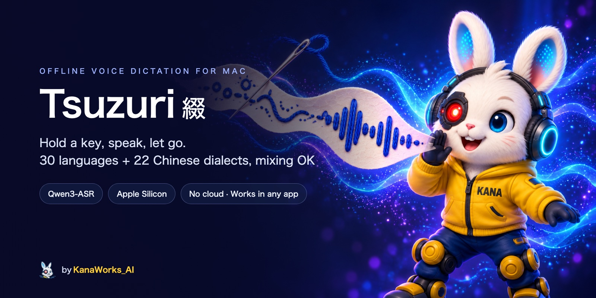

<div align="center">



<p>
  <a href="LICENSE"></a>
  
  
  <a href="https://github.com/kanaworksai-hue/tsuzuri/releases/latest"></a>
  <a href="https://github.com/kanaworksai-hue/tsuzuri/stargazers"></a>
</p>

<p><a href="https://github.com/kanaworksai-hue"></a>&nbsp;<a href="https://github.com/kanaworksai-hue"><b>A KanaWorks_AI project</b></a></p>

**English** | [日本語](README.ja.md) | [简体中文](README.zh-CN.md)

[Install](#-install) · [Use it](#%EF%B8%8F-use-it) · [Languages](#-languages) · [Polish](#-polish-optional) · [Build from source](#-build-from-source) · [Command line](#-command-line) · [FAQ](#-faq)

</div>

**Tsuzuri 綴** (Japanese for "to stitch words together") is offline voice dictation for macOS. Hold a key, speak, let go: the text appears wherever your cursor is. It recognizes **30 languages and 22 Chinese dialects**, and is tuned for **Chinese, English and Japanese, including any mix of them in one sentence**, without switching modes.

Recognition runs entirely on your Mac with [Qwen3-ASR](https://github.com/QwenLM/Qwen3-ASR) on Apple Silicon via [MLX](https://github.com/ml-explore/mlx-swift). No cloud, no account, and no audio leaves your computer.

## ✨ Features

- **Menu bar app**, no Dock icon
- **Push-to-talk**: hold the trigger key (right ⌥ Option by default; right ⌘ Command or Fn also work) while you speak, or tap it to start and tap again to stop. Esc cancels.
- **30 languages**, detected automatically every time (see [Languages](#-languages))
- **Mixed-language speech**: "明日の stand-up は skip して、PR の review を先にやろう" just works
- **Works in any app**, also with Chinese or Japanese input methods turned on: the text is pasted through the clipboard, and your clipboard is restored afterwards
- **Nothing you said gets lost**: if no text field has focus, the text stays on the clipboard, and the menu keeps your last 10 results (in memory only)
- **Two model sizes**: Qwen3-ASR 1.7B (more accurate) and 0.6B (faster)
- **Polish** (optional): a small local model adds punctuation, removes filler words and writes numbers as digits (in 7 languages)
- Silence trimming with [Silero VAD](https://github.com/snakers4/silero-vad)
- Menus in all 30 languages, following your macOS language

## 📦 Install

**Requirements:** a Mac with Apple Silicon (M1 or later) and macOS 14 Sonoma or later. About 2 GB of free memory while Tsuzuri is running.

### 1. Download the app

Download `Tsuzuri-<version>.dmg` from the [latest release](https://github.com/kanaworksai-hue/tsuzuri/releases/latest), open it and drag **Tsuzuri** into **Applications**. The app is signed and notarized by Apple.

### 2. Download a speech model

The models are not included in the app. Tsuzuri looks for them in `~/Library/Application Support/Tsuzuri/Models/`. The easiest way to download them is with [uv](https://docs.astral.sh/uv/) (`brew install uv`). Paste this into Terminal:

```bash
M="$HOME/Library/Application Support/Tsuzuri/Models"
for repo in Qwen3-ASR-1.7B-4bit silero-vad; do
  uvx --from huggingface_hub hf download "mlx-community/$repo" --local-dir "$M/$repo"
done
```

This downloads about 1.5 GB. For the faster, smaller model, add `Qwen3-ASR-0.6B-8bit` to the list (about 1 GB). You can switch between installed models from the menu.

> If you already have the Hugging Face CLI (`hf`), you can use `hf download mlx-community/<repo> --local-dir "$M/<repo>"` instead.

### 3. First run

1. Open **Tsuzuri** from Applications. A small icon appears in the menu bar.
2. Allow **Microphone** access when macOS asks.
3. Allow **Accessibility** in System Settings → Privacy & Security → Accessibility. Tsuzuri needs it for the global hotkey and for pasting. The menu has a shortcut to this page.
4. If you downloaded the models while Tsuzuri was running, quit and reopen it.

## 🎙️ Use it

1. Click into any text field: Notes, a browser, Slack, Terminal, …
2. **Hold right ⌥ Option**, speak, and let go. A small overlay shows "Listening…", then "Transcribing…".
3. The text is pasted where your cursor is.

Tap the key instead of holding it to keep recording hands-free; tap again to stop. Press Esc, or another key while holding the trigger, to cancel.

From the menu bar icon you can choose the model, the spoken language (Auto, or one of the 30 languages), the trigger key, turn Polish on or off, and copy one of your recent results again.

## 🌐 Languages

Tsuzuri recognizes all the languages of Qwen3-ASR. In **Auto** mode (the default) it detects the language of each dictation, so you never switch modes. If a short phrase comes out in the wrong language, pick your language in the menu under **Spoken Language**.

| | |
|---|---|
| **Tuned and tested for** | English, Japanese and Chinese, including mixing them in one sentence |
| **Also recognized** | Arabic, Cantonese, Czech, Danish, Dutch, Filipino, Finnish, French, German, Greek, Hindi, Hungarian, Indonesian, Italian, Korean, Macedonian, Malay, Persian, Polish, Portuguese, Romanian, Russian, Spanish, Swedish, Thai, Turkish, Vietnamese |
| **Chinese dialects (22)** | Anhui, Dongbei, Fujian, Gansu, Guizhou, Hebei, Henan, Hubei, Hunan, Jiangxi, Ningxia, Shandong, Shaanxi, Shanxi, Sichuan, Tianjin, Yunnan, Zhejiang, Cantonese (Hong Kong), Cantonese (Guangdong), Wu, Min Nan |
| **Polish** | English, German, Spanish, French, Chinese, Russian, Japanese |
| **Menus** | All 30 languages (Cantonese uses Traditional Chinese) |

## 🪡 Polish (optional)

Polish runs a second small model, [spokenly/cleanup-1](https://huggingface.co/spokenly/cleanup-1), after recognition. It adds punctuation, removes filler words ("um", "uh", "えーと"), keeps only the corrected version when you correct yourself, and writes numbers as digits. It never translates or answers what you said.

The model was trained on **English, German, Spanish, French, Chinese, Russian and Japanese**. Tsuzuri checks the language each dictation was recognized as and skips Polish for every other language, so those are pasted exactly as recognized.

If the result looks wrong (much longer, a different script, words or numbers you didn't say, or slower than 1 second), Tsuzuri pastes the raw transcript instead. Polish is skipped in terminal apps, where you usually dictate commands. It adds about 0.35 GB of memory.

There is no ready-made MLX version of this model, so convert it once on your Mac (downloads the 1.2 GB original):

```bash
uvx --from 'mlx-lm==0.32.*' mlx_lm.convert --hf-path spokenly/cleanup-1 -q --q-bits 4 \
  --mlx-path "$HOME/Library/Application Support/Tsuzuri/Models/cleanup-1-4bit"
```

Then reopen Tsuzuri and turn on **Polish** in the menu. It is off by default.

## 🛠️ Build from source

You need Xcode 26 or later (Swift 6.2).

```bash
git clone https://github.com/kanaworksai-hue/tsuzuri.git
cd tsuzuri
scripts/build-app.sh          # → build/Tsuzuri.app and .build/release/tsuzuri-cli
ditto build/Tsuzuri.app /Applications/Tsuzuri.app
```

If `xcode-select` points at the Command Line Tools, the scripts use `DEVELOPER_DIR=/Applications/Xcode.app/Contents/Developer` automatically.

`build-app.sh` signs the app with your first "Apple Development" certificate, or ad-hoc if there is none. macOS ties the Microphone and Accessibility permissions to the signature, so with an ad-hoc signature you have to grant them again after every rebuild.

`scripts/release.sh <version>` builds a DMG signed with a "Developer ID Application" certificate and notarizes it (see the comments in the script; `SKIP_NOTARIZE=1` only signs). Please use your own icon if you publish your own build (see [Brand](#-license)).

**Translations:** UI strings are written in English in the source (`String(localized:)` and SwiftUI `Text`). The translations, one folder per language, are in `Resources/Localization/`. After adding or changing a string, run `python3 scripts/check-l10n.py` to find missing translations.

## ⌨️ Command line

`tsuzuri-cli` transcribes audio files with the same engine. It needs `mlx.metallib` next to it, which `scripts/build-app.sh` takes care of.

```bash
.build/release/tsuzuri-cli recording.wav
.build/release/tsuzuri-cli --model Qwen3-ASR-0.6B-8bit --language Japanese a.wav b.m4a   # or German, Korean, …
.build/release/tsuzuri-cli --jsonl *.wav                      # one JSON line per file, with timings
.build/release/tsuzuri-cli --polish recording.wav             # recognition, then Polish
.build/release/tsuzuri-cli --polish-text lines.txt            # Polish text only
```

Run `tsuzuri-cli --help` for all options. Set `TSUZURI_MODELS_DIR` to use a different models folder.

## ❓ FAQ

**Does anything leave my Mac?** No. Recording, recognition and Polish all run locally. Tsuzuri only uses the network when *you* run the download commands above.

**Is my speech saved anywhere?** Audio is never written to disk. Recent results are kept in memory for the menu and are gone when you quit. `~/Library/Logs/Tsuzuri.log` records timings and errors but not what you said (`defaults write com.kanaworks.tsuzuri logText -bool true` adds the text, for debugging).

**Why does it paste through the clipboard instead of typing?** Pasting works the same in every app and with every input method turned on. Tsuzuri puts your previous clipboard back afterwards. When it can't tell whether a text field has focus (some Electron apps), it pastes and leaves the text on the clipboard so you can paste it again.

**Which model should I use?** Start with Qwen3-ASR 1.7B (4bit). If you want faster results or less memory use, try 0.6B (8bit).

**Known limits:** short Japanese phrases inside Chinese sentences are sometimes written in romaji or as Chinese sound-alikes. English loanwords in Japanese speech are often written in katakana (staging → ステージング). The paste shortcut assumes a QWERTY-style key position for V.

## 🙏 Acknowledgements

- [Qwen3-ASR](https://github.com/QwenLM/Qwen3-ASR) by the Qwen team (Apache-2.0)
- [mlx-audio-swift](https://github.com/Blaizzy/mlx-audio-swift), [MLX Swift](https://github.com/ml-explore/mlx-swift) and [mlx-swift-lm](https://github.com/ml-explore/mlx-swift-lm) (MIT)
- [Silero VAD](https://github.com/snakers4/silero-vad) (MIT)
- [spokenly/cleanup-1](https://huggingface.co/spokenly/cleanup-1) (Apache-2.0)
- Ideas from [Parrot](https://github.com/banyudu/parrot) and [Koe](https://github.com/imshire/koe) (MIT)

Full list with licenses: [THIRD_PARTY.md](THIRD_PARTY.md).

## 📄 License

- **This project:** [MIT](LICENSE).
- **Models:** downloaded from Hugging Face, not distributed here. See [THIRD_PARTY.md](THIRD_PARTY.md).
- **Brand:** the KanaWorks_AI name, logo and the Kana character (including the app icon and the banner) are © KanaWorks_AI and are **not** covered by the MIT license. See [docs/brand](docs/brand/README.md).

This is an independent project. It is not affiliated with or endorsed by Alibaba Cloud, the Qwen team or Apple.

<br>

<div align="center">

<a href="https://x.com/KanaWorks_AI"></a>

<p><b>Made with ♥ by <a href="https://x.com/KanaWorks_AI">KanaWorks_AI</a></b></p>

<p><sub>If Tsuzuri saves you some typing, a ⭐ helps the project keep going and helps others find it. More projects: <a href="https://github.com/kanaworksai-hue">github.com/kanaworksai-hue</a></sub></p>

</div>
