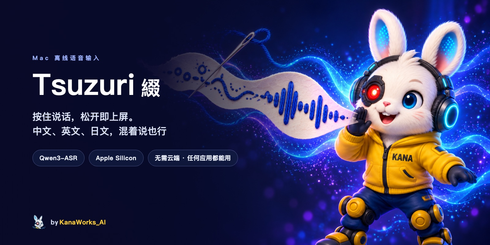

<div align="center">



<p>
  <a href="LICENSE"></a>
  
  
  <a href="https://github.com/kanaworksai-hue/tsuzuri/releases/latest"></a>
  <a href="https://github.com/kanaworksai-hue/tsuzuri/stargazers"></a>
</p>

<p><a href="https://github.com/kanaworksai-hue"></a>&nbsp;<a href="https://github.com/kanaworksai-hue"><b>A KanaWorks_AI project</b></a></p>

[English](README.md) | [日本語](README.ja.md) | **简体中文**

[安装](#-安装) · [使用方法](#%EF%B8%8F-使用方法) · [支持的语言](#-支持的语言) · [润色](#-润色) · [从源码构建](#%EF%B8%8F-从源码构建) · [命令行](#%EF%B8%8F-命令行) · [常见问题](#-常见问题)

</div>

**Tsuzuri 綴**（日语「つづり」，意思是把字词缝缀在一起）是一款 macOS 离线语音输入工具。按住一个键说话，松开后文字就出现在光标所在的位置。它能识别 **30 种语言和 22 种中文方言**，并且重点针对**中文、英文、日文，以及同一句话里混着说的情况**做了优化，不用切换模式。

识别完全在你的 Mac 上完成：通过 [MLX](https://github.com/ml-explore/mlx-swift) 在 Apple Silicon 上运行 [Qwen3-ASR](https://github.com/QwenLM/Qwen3-ASR)。不需要云端，不需要账号，声音不会离开你的电脑。

## ✨ 功能

- **常驻菜单栏**，不占 Dock
- **按住说话**：说话时按住触发键（默认右 ⌥ Option，也可以选右 ⌘ Command 或 Fn）；也可以轻按一下开始、再按一下结束。按 Esc 取消
- **支持 30 种语言**：每次说话自动判断语言（见[支持的语言](#-支持的语言)）
- **混着说也没问题**：「把明天的 meeting 改到三点，顺便 review 一下这个 PR」直接就能输入
- **任何应用都能用**，开着中文或日文输入法也可以：文字通过剪贴板粘贴，之后会恢复你原来的剪贴板内容
- **说过的话不会丢**：没有文本框获得焦点时，文字会留在剪贴板里；菜单里保留最近 10 条结果（只在内存中）
- **两种模型大小**：Qwen3-ASR 1.7B（更准）和 0.6B（更快）
- **润色**（可选）：用一个本地小模型加标点、去掉口头语、把数字写成阿拉伯数字（支持 7 种语言）
- 用 [Silero VAD](https://github.com/snakers4/silero-vad) 去掉首尾静音
- 菜单支持全部 30 种语言，跟随 macOS 的系统语言

## 📦 安装

**系统要求：** Apple Silicon（M1 或更新）的 Mac，macOS 14 Sonoma 或更新版本。运行时大约需要 2 GB 空闲内存。

### 1. 下载 App

从[最新发布](https://github.com/kanaworksai-hue/tsuzuri/releases/latest)下载 `Tsuzuri-<版本>.dmg`，打开后把 **Tsuzuri** 拖进 **应用程序** 文件夹。App 已经过 Apple 签名和公证。

### 2. 下载语音识别模型

App 里不包含模型。Tsuzuri 从 `~/Library/Application Support/Tsuzuri/Models/` 读取模型。最简单的下载方法是用 [uv](https://docs.astral.sh/uv/)（`brew install uv` 安装）。把下面这段粘贴到终端里运行：

```bash
M="$HOME/Library/Application Support/Tsuzuri/Models"
for repo in Qwen3-ASR-1.7B-4bit silero-vad; do
  uvx --from huggingface_hub hf download "mlx-community/$repo" --local-dir "$M/$repo"
done
```

大约要下载 1.5 GB。如果还想要更快、更小的模型，把 `Qwen3-ASR-0.6B-8bit` 加到列表里（约 1 GB）。已下载的模型可以在菜单里切换。

> 如果你已经装了 Hugging Face CLI（`hf`），也可以用 `hf download mlx-community/<repo> --local-dir "$M/<repo>"`。

### 3. 第一次运行

1. 从应用程序文件夹打开 **Tsuzuri**，菜单栏会出现一个小图标。
2. macOS 询问时，允许访问 **麦克风**。
3. 在 系统设置 → 隐私与安全性 → 辅助功能 里允许 **Tsuzuri**。全局快捷键和粘贴都需要这个权限。菜单里有直接打开这个页面的入口。
4. 如果是在 Tsuzuri 运行时下载的模型，请退出后重新打开。

## 🎙️ 使用方法

1. 点进任意一个文本框：备忘录、浏览器、Slack、终端……
2. **按住右 ⌥ Option** 说话，然后松开。屏幕上的小提示会先显示「聆听中…」，再显示「识别中…」。
3. 文字会粘贴到光标所在的位置。

如果不想一直按着，可以轻按一下开始录音，说完再按一下结束。按 Esc，或者在按住触发键时按其他键，可以取消。

点菜单栏图标可以选择模型、识别语言（「自动」，或者固定为 30 种语言中的一种）、快捷键，开关润色，还可以重新复制最近的识别结果。

## 🌐 支持的语言

Tsuzuri 能识别 Qwen3-ASR 支持的全部语言。默认的 **自动** 模式每次说话都会自己判断语言，不用切换模式。如果某句短话被认成了别的语言，可以在菜单 **识别语言** 里固定成你说的语言。

| | |
|---|---|
| **重点优化和测试** | 中文、英文、日文，以及同一句话里混着说 |
| **其他支持的语言** | 阿拉伯语、波兰语、波斯语、丹麦语、德语、俄语、法语、菲律宾语、芬兰语、韩语、荷兰语、捷克语、罗马尼亚语、马其顿语、马来语、葡萄牙语、瑞典语、泰语、土耳其语、西班牙语、希腊语、匈牙利语、意大利语、印地语、印尼语、越南语、粤语 |
| **中文方言（22 种）** | 安徽、东北、福建、甘肃、贵州、河北、河南、湖北、湖南、江西、宁夏、山东、陕西、山西、四川、天津、云南、浙江、粤语（香港）、粤语（广东）、吴语、闽南语 |
| **润色** | 英语、德语、西班牙语、法语、中文、俄语、日语 |
| **菜单** | 上面全部 30 种语言（粤语用繁体中文界面） |

## 🪡 润色

打开润色后，识别完成后会再用一个小模型 [spokenly/cleanup-1](https://huggingface.co/spokenly/cleanup-1) 处理一遍：加标点，去掉「嗯」「那个」「um」这类口头语，说错改口时只保留改过的说法，把数字写成阿拉伯数字。它不会翻译，也不会回答你说的内容。

这个模型只训练过 **英语、德语、西班牙语、法语、中文、俄语、日语**。Tsuzuri 会看每次识别出来的语言，其他语言一律不润色，按识别结果原样粘贴。

如果润色结果看起来不对（变长很多、文字种类变了、出现你没说过的词或数字、超过 1 秒），Tsuzuri 会改为粘贴润色前的原始结果。在终端类应用里不润色，因为在那里说的通常是命令。润色会多占用约 0.35 GB 内存。

这个模型没有现成的 MLX 版本，需要在你的 Mac 上转换一次（会下载 1.2 GB 的原始模型）：

```bash
uvx --from 'mlx-lm==0.32.*' mlx_lm.convert --hf-path spokenly/cleanup-1 -q --q-bits 4 \
  --mlx-path "$HOME/Library/Application Support/Tsuzuri/Models/cleanup-1-4bit"
```

转换完成后重新打开 Tsuzuri，在菜单里打开 **润色**。默认是关闭的。

## 🛠️ 从源码构建

需要 Xcode 26 或更新版本（Swift 6.2）。

```bash
git clone https://github.com/kanaworksai-hue/tsuzuri.git
cd tsuzuri
scripts/build-app.sh          # → build/Tsuzuri.app 和 .build/release/tsuzuri-cli
ditto build/Tsuzuri.app /Applications/Tsuzuri.app
```

即使 `xcode-select` 指向的是 Command Line Tools，脚本也会自动使用 `DEVELOPER_DIR=/Applications/Xcode.app/Contents/Developer`。

`build-app.sh` 会用找到的第一个「Apple Development」证书签名，没有的话就用临时签名（ad-hoc）。macOS 把麦克风和辅助功能权限和签名绑定在一起，所以用临时签名时，每次重新构建都要重新授权。

`scripts/release.sh <版本>` 会用「Developer ID Application」证书签名并制作 DMG，然后提交公证（详见脚本里的注释；`SKIP_NOTARIZE=1` 只签名不公证）。如果你发布自己构建的版本，请换用自己的图标（见[许可证](#-许可证)）。

**翻译：** 界面文字在源码里用英文写（`String(localized:)` 和 SwiftUI 的 `Text`），各语言的翻译按语言分文件夹放在 `Resources/Localization/`。添加或修改文字后，运行 `python3 scripts/check-l10n.py` 检查有没有漏翻。

## ⌨️ 命令行

`tsuzuri-cli` 用同一个引擎把音频文件转成文字。它需要可执行文件旁边有 `mlx.metallib`，`scripts/build-app.sh` 会处理好。

```bash
.build/release/tsuzuri-cli recording.wav
.build/release/tsuzuri-cli --model Qwen3-ASR-0.6B-8bit --language Chinese a.wav b.m4a   # 也可以是 German、Korean 等
.build/release/tsuzuri-cli --jsonl *.wav                      # 每个文件输出一行 JSON（含耗时）
.build/release/tsuzuri-cli --polish recording.wav             # 识别后再润色
.build/release/tsuzuri-cli --polish-text lines.txt            # 只润色文字
```

运行 `tsuzuri-cli --help` 查看全部选项。想把模型放在别的文件夹，设置 `TSUZURI_MODELS_DIR` 即可。

## ❓ 常见问题

**会有数据离开我的 Mac 吗？** 不会。录音、识别和润色都在本地运行。只有在*你自己*运行上面的下载命令时才会用到网络。

**我说的话会被保存吗？** 声音不会写入磁盘。最近的识别结果只为菜单保存在内存里，退出就没了。`~/Library/Logs/Tsuzuri.log` 只记录耗时和错误，不记录你说的内容（调试时可以用 `defaults write com.kanaworks.tsuzuri logText -bool true` 让它记录文字）。

**为什么用剪贴板粘贴，而不是模拟打字？** 粘贴在任何应用、任何输入法下的表现都一样。Tsuzuri 之后会恢复你原来的剪贴板。如果判断不了是否有文本框获得焦点（部分 Electron 应用），它会粘贴，同时把文字留在剪贴板里，方便你再粘贴一次。

**该用哪个模型？** 先用 Qwen3-ASR 1.7B（4bit）。想要更快或更省内存，试试 0.6B（8bit）。

**已知限制：** 中文句子里夹的日语短句，有时会被写成罗马字或中文音译。日语里的英文单词常被写成片假名（staging → ステージング）。粘贴快捷键默认 V 键在 QWERTY 布局的位置。

## 🙏 致谢

- Qwen 团队的 [Qwen3-ASR](https://github.com/QwenLM/Qwen3-ASR)（Apache-2.0）
- [mlx-audio-swift](https://github.com/Blaizzy/mlx-audio-swift)、[MLX Swift](https://github.com/ml-explore/mlx-swift) 和 [mlx-swift-lm](https://github.com/ml-explore/mlx-swift-lm)（MIT）
- [Silero VAD](https://github.com/snakers4/silero-vad)（MIT）
- [spokenly/cleanup-1](https://huggingface.co/spokenly/cleanup-1)（Apache-2.0）
- 参考了 [Parrot](https://github.com/banyudu/parrot) 和 [Koe](https://github.com/imshire/koe)（MIT）的思路

带许可证的完整列表：[THIRD_PARTY.md](THIRD_PARTY.md)

## 📄 许可证

- **本项目：** [MIT](LICENSE)
- **模型：** 从 Hugging Face 下载，本仓库不分发。详见 [THIRD_PARTY.md](THIRD_PARTY.md)。
- **品牌：** KanaWorks_AI 名称、logo 和 Kana 形象（包括 App 图标和横幅）版权归 KanaWorks_AI 所有，**不在** MIT 授权范围内。详见 [docs/brand](docs/brand/README.md)。

本项目是独立项目，与阿里云、Qwen 团队和 Apple 没有关联，也未获得其认可。

<br>

<div align="center">

<a href="https://x.com/KanaWorks_AI"></a>

<p><b>Made with ♥ by <a href="https://x.com/KanaWorks_AI">KanaWorks_AI</a></b></p>

<p><sub>如果 Tsuzuri 帮你少打了一些字，点个 ⭐ 能支持项目继续下去，也能让更多人发现它。更多项目：<a href="https://github.com/kanaworksai-hue">github.com/kanaworksai-hue</a></sub></p>

</div>
